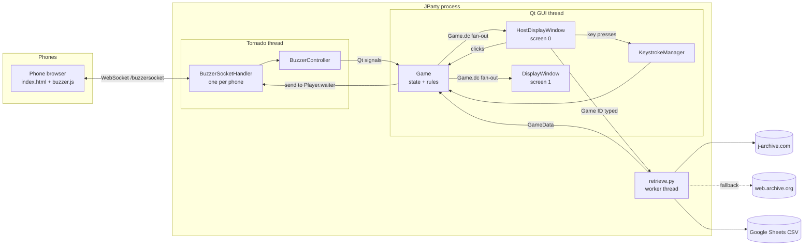
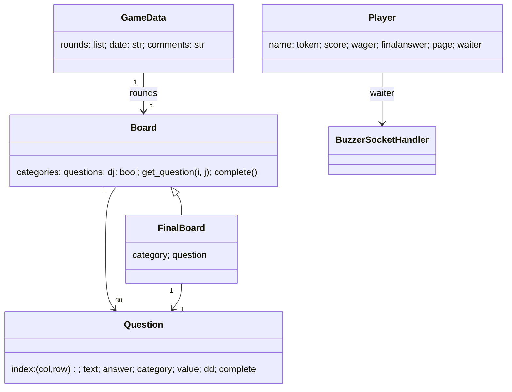

# Architecture

JParty (v2.1.1) is a single-process Python desktop app, about 3,900 lines. It has three parts:

1. A **PyQt6 GUI** with two full-screen windows: the host view (screen 0) and the player-facing board (screen 1).
2. A **Tornado web server** on port 8080, running in a daemon thread, which serves the phone buzzer page and holds one WebSocket per player.
3. A **scraper** that downloads a game from J-Archive, the Wayback Machine, or a Google Sheet.

One `Game` object owns all state and sits in the middle.



## Startup sequence

[jparty/main.py](../jparty/main.py) `main()`:

1. Create the `QApplication` with the custom `JPartyStyle`.
2. `check_second_monitor()`: exit if fewer than two screens.
3. `check_internet()`: exit if `j-archive.com` is unreachable.
4. Load the Korinna font.
5. Create `Game`, then `BuzzerController(game)`, and wire them to each other.
6. `socket_controller.start()`: listen on port 8080 (tries the next port up, about 11 times, if busy) and start the Tornado IO loop in a daemon thread.
7. Create `DisplayWindow` and `HostDisplayWindow`; `game.setDisplays(host, main)`.
8. Start the theme song and enter the Qt event loop.

Importing [jparty/logger.py](../jparty/logger.py) installs a global `sys.excepthook` that logs to `latest.log` and offers to email a crash report.

## Module map

| Module | Lines | Role |
| --- | --- | --- |
| [run.py](../run.py) | 5 | Entry point; calls `jparty.main.main()`. |
| [main.py](../jparty/main.py) | 113 | Startup checks and wiring. |
| [game.py](../jparty/game.py) | 694 | `Game` (state machine and rules), data classes (`Question`, `Board`, `FinalBoard`, `GameData`, `Player`), `KeystrokeManager`, `QuestionTimer`. |
| [controller.py](../jparty/controller.py) | 243 | Tornado app, HTTP and WebSocket handlers, `BuzzerController`. |
| [retrieve.py](../jparty/retrieve.py) | 188 | Download and parse games. |
| [main_display.py](../jparty/main_display.py) | 277 | `DisplayWindow` and `HostDisplayWindow`. |
| [welcome_widget.py](../jparty/welcome_widget.py) | 337 | Start menu (`Welcome`, host) and QR code (`QRWidget`, players). |
| [board_widget.py](../jparty/board_widget.py) | 199 | The 6x5 grid of cards (unused columns hidden) and the reveal animation. |
| [question_widget.py](../jparty/question_widget.py) | 138 | Clue, Daily Double and Final Jeopardy views. |
| [scoreboard.py](../jparty/scoreboard.py) | 239 | Podiums (`PlayerWidget`) and the scoreboard row. |
| [borders.py](../jparty/borders.py) | 158 | Side strips: white "buzzers open" lights; key hints on the host. |
| [final_display.py](../jparty/final_display.py) | 55 | Final Jeopardy answer/wager/winner overlay. |
| [settings.py](../jparty/settings.py) | 226 | In-game settings, player settings, "accepting new players" popup. |
| [utils.py](../jparty/utils.py) | 304 | `resource_path`, `SongPlayer`, `CompoundObject`, auto-sizing labels, `DDWagerDialog`. |
| [style.py](../jparty/style.py) | 60 | Qt style, palettes, `MyLabel`. |
| [logger.py](../jparty/logger.py) | 96 | Logging and crash reporter. |
| [constants.py](../jparty/constants.py) | 11 | Timings, port, max players, dollar values, whether to play the final round and reveal answers on the TV. |
| [environ.py](../jparty/environ.py), [version.py](../jparty/version.py), [helpmsg.py](../jparty/helpmsg.py) | | Frozen-app root path, version string, help text. |
| [buzzer/](../jparty/buzzer/) | | Phone client: one HTML template, `buzzer.js`, `style.css`. |
| [data/](../jparty/data/) | | Sounds, images and font loaded via `resource_path`. |

## Import graph

Arrows point from importer to imported. `utils`, `constants`, `environ` and `version` are leaves.

```mermaid
flowchart TD
    run --> main
    main --> game & controller & main_display & style & logger
    controller --> game
    main_display --> board_widget & scoreboard & borders & question_widget & settings & final_display & welcome_widget
    settings --> welcome_widget
    welcome_widget --> retrieve & helpmsg & style
    retrieve --> game
    board_widget --> game & style
    final_display --> scoreboard & style
    scoreboard --> style
    question_widget --> style
    style --> utils
    game --> utils
```

(Edges to `utils`, `constants`, `environ` and `version` are mostly omitted for readability; the full set is in [knowledge-graph.json](knowledge-graph.json).)

## Design patterns worth knowing

**Host/player class pairs.** Every screen element has a base class used on the player screen and a `Host…` subclass that adds interaction or the answer. `DisplayWindow` has factory methods (`create_score_board`, `create_border_widget`, `create_question_widget`, …) which `HostDisplayWindow` overrides. The one deliberate exception: `QuestionWidget.show_answer` puts the answer on the TV once a clue is over, when `SHOW_ANSWER` is on.

| Player screen | Host screen | What the host version adds |
| --- | --- | --- |
| `DisplayWindow` | `HostDisplayWindow` | Key handling, gear button, player-in-control glow |
| `QRWidget` | `Welcome` | Game ID box, Start/Random/Help/Quit |
| `QuestionCard` | `HostQuestionCard` | Click to open, hover highlight |
| `QuestionWidget` | `HostQuestionWidget` | Answer line |
| `DailyDoubleWidget` | `HostDailyDoubleWidget` | "Click the player…" hint, answer |
| `FinalJeopardyWidget` | `HostFinalJeopardyWidget` | Wager-waiting hint, answer |
| `ScoreBoard` / `PlayerWidget` | `HostScoreBoard` / `HostPlayerWidget` | Remove-player button |
| `Borders` / `BorderWidget` | `HostBorders` / `HostBorderWidget` | Space/arrow hint images, red/green |

**`CompoundObject` fan-out.** `Game.dc = CompoundObject(host_display, main_display)`. Any attribute access or call on `dc` is applied to both windows, so `self.dc.load_question(q)` updates both screens. Use `self.host_display` or `self.main_display` directly when only one should change.

**`KeystrokeManager` as the state machine.** There is no explicit state enum. The game's state is which named key events are currently active. Each `Game` method activates the events that are valid next; non-persistent events deactivate themselves when fired. See [game-flow.md](game-flow.md).

**Thread crossing via Qt signals.** WebSocket messages arrive on the Tornado thread. `BuzzerController` emits `Game.buzz_trigger`, `wager_trigger` and `new_player_trigger`, which Qt delivers on the GUI thread. Game downloads run in a plain `Thread` and report back through `Welcome.gameid_trigger` / `summary_trigger`. Several light/flash animations use raw threads that call widget methods directly.

**Paths depend on the working directory.** `resource_path()` resolves to `<cwd>/data/…` in development and `sys._MEIPASS/data/…` when frozen. Tornado's template and static paths are relative to `environ.root`, which is `""` in development. This is why the app must be launched from inside `jparty/`.

## Game data model



`GameData.rounds` is always `[Board, Board(dj=True), FinalBoard]`. A board is only playable if it has exactly 30 clues (`Board.complete()`), which is why episodes with unrevealed clues are rejected. `Player.name` is either plain text or a `data:image/png;base64,…` signature drawn on the phone.

## Game sources

`get_game(game_id)` in [retrieve.py](../jparty/retrieve.py) picks a source by ID length:

- **Shorter than 7 characters:** J-Archive (`showgame.php?game_id=N`), scraped with BeautifulSoup. On failure, the newest Wayback Machine snapshot of the same page.
- **7 or more characters:** a Google Sheet ID, fetched as CSV.

Google Sheet layout expected by `list_to_game` (1-indexed rows, as in the spreadsheet):

| Rows | Content |
| --- | --- |
| 1 | Round 1 categories in columns B–G. The last cell lists Daily Double cell addresses (e.g. `C4`). |
| 2–6 | Round 1 clues; column A is the dollar value. |
| 8–12 | Round 1 answers. |
| 14 | Round 2 categories, Daily Doubles in the last cell. |
| 15–19 | Round 2 clues. |
| 21–25 | Round 2 answers. |
| Last row | Final: B = category, C = clue, D = answer, F = date/title, H = comments. |

## Build and release

- [JParty.spec](../JParty.spec): PyInstaller spec. Bundles `jparty/data/*` as `data/` and `jparty/buzzer` as `buzzer/`; builds a `.app` bundle on macOS.
- [compile](../compile): local macOS helper that builds and zips for the current architecture.
- [.github/workflows/main.yml](../.github/workflows/main.yml): manually triggered; builds Linux, Windows, macOS arm64 and macOS x86 with Python 3.11.
- Dependencies are pinned in [pyproject.toml](../pyproject.toml) (locked in `uv.lock`) and mirrored in [requirements.txt](../requirements.txt), which the release workflow installs from, and [environment.yml](../environment.yml). The project version in `pyproject.toml` is read from `jparty/version.py`.
- There are no automated tests.

## Tunables

All in [constants.py](../jparty/constants.py):

| Constant | Value | Meaning |
| --- | --- | --- |
| `QUESTIONTIME` | 4 s | Buzz window before the clue times out |
| `FJTIME` | 31 s | Final Jeopardy answer time |
| `BUZZER_DELAY` | 0.25 s | Pause between the lights and buzzers actually opening |
| `MAXPLAYERS` | 8 | |
| `PORT` | 8080 | First port tried for the buzzer server |
| `MONIES` | 200–1000, 400–2000 | Clue values for J-Archive games |
| `PLAY_FINAL` | True | False skips the final round: after round 2 the winner is shown |
| `SHOW_ANSWER` | True | After each clue, an extra Space shows the correct answer on the TV |
| `CATEGORY_REVEAL_TIME`, `QUESTION_REVEAL_TIME`, `BEFORE_REVEAL_WAIT_TIME` | 2000, 400, 100 ms | Board reveal animation |
