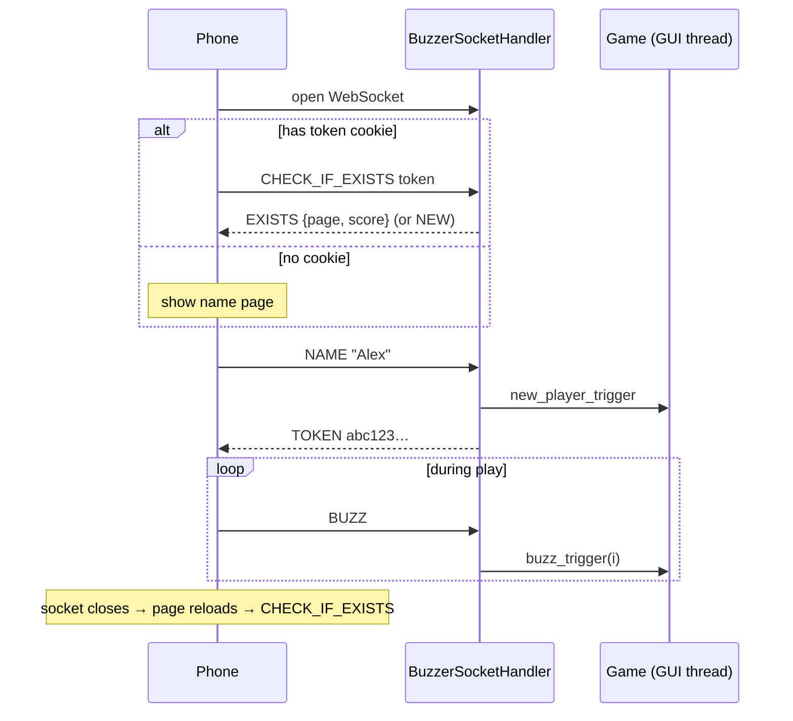

# Buzzer protocol

The phone client is a single page served by Tornado. Server side: [jparty/controller.py](../jparty/controller.py). Client side: [index.html](../jparty/buzzer/templates/index.html), [buzzer.js](../jparty/buzzer/static/buzzer.js), [style.css](../jparty/buzzer/static/style.css).

## Endpoints

| Route | Handler | Purpose |
| --- | --- | --- |
| `GET /` | `WelcomeHandler` | Serves `index.html` |
| `WS /buzzersocket` | `BuzzerSocketHandler` | One socket per phone |
| `GET /static/…` | Tornado static | `buzzer.js`, `style.css`, background, favicon |
| `POST /play` | `BuzzerHandler` | Unused leftover; renders a `play.html` that does not exist |

The server listens on `PORT` (8080), moving to the next port if it is taken. The address shown under the QR code comes from `BuzzerController.host()`, which finds the LAN IP by opening a UDP socket towards `8.8.8.8`.

The socket is pinged every 0.19 s with the ping timeout disabled (`websocket_ping_interval=0.19`, `websocket_ping_timeout=0`), and `TCP_NODELAY` is set, to keep latency low.

## Message format

Both directions use JSON: `{"message": "<TYPE>", "text": "<payload>"}`.

To minimise latency, the server checks for the substring `BUZZ` in the raw message before parsing any JSON.

### Phone → server

| Message | Payload | Effect |
| --- | --- | --- |
| `CHECK_IF_EXISTS` | token (hex) | Sent on connect if a `token` cookie exists. Server replies `EXISTS` or `NEW`. |
| `NAME` | typed name, or a `data:image/png;base64,…` signature | Creates a `Player`. Replies `TOKEN`, `GAMESTARTED` or `FULL`. |
| `BUZZ` | none | Emits `Game.buzz_trigger(player_index)`. |
| `WAGER` | integer as string | Emits `Game.wager_trigger(player_index, amount)`. |
| `ANSWER` | text | Stores `player.finalanswer`. |

### Server → phone

| Message | Payload | Phone reaction |
| --- | --- | --- |
| `NEW` | none | Show the name/signature page |
| `TOKEN` | token (hex) | Store as a 24-hour cookie; show the buzzer |
| `EXISTS` | JSON `{"page", "score"}` | Restore the page the player was on |
| `GAMESTARTED` | none | Alert "Game has started!" |
| `FULL` | none | Sent when 8 players are connected (the client listens for `GAMEFULL` instead, see [known-issues.md](known-issues.md)) |
| `PROMPTWAGER` | max wager (`max(score, 0)`) | Show the wager form |
| `BACK` | none | Return to the buzzer (sent when leaving the final via Previous round) |
| `PROMPTANSWER` | none | Show the answer form |
| `TOOLATE` | none | Submit whatever is in the answer box |

## Phone pages

The page contains four `div`s; `load_page(name)` shows one and hides the previous. The server mirrors the current one in `Player.page` so a reconnecting phone lands in the right place.

| Page | Shown when |
| --- | --- |
| `name` | New player: signature canvas, or the Keyboard button to type |
| `buzz` | Normal play: one big BUZZ! button, disabled for 250 ms after each press |
| `wager` | Final round wager |
| `answer` | Final round answer |
| `null` | Nothing (after submitting a wager or answer) |

## Connection lifecycle

The client reloads the page whenever the socket closes, so a dropped connection recovers by itself as long as the cookie is present and the game has not been closed.

## External dependencies of the phone page

`index.html` loads jQuery (over plain `http://`), `signature_pad`, the Anton font and W3.CSS from public CDNs. Phones therefore need internet access, not only a route to the host computer.
