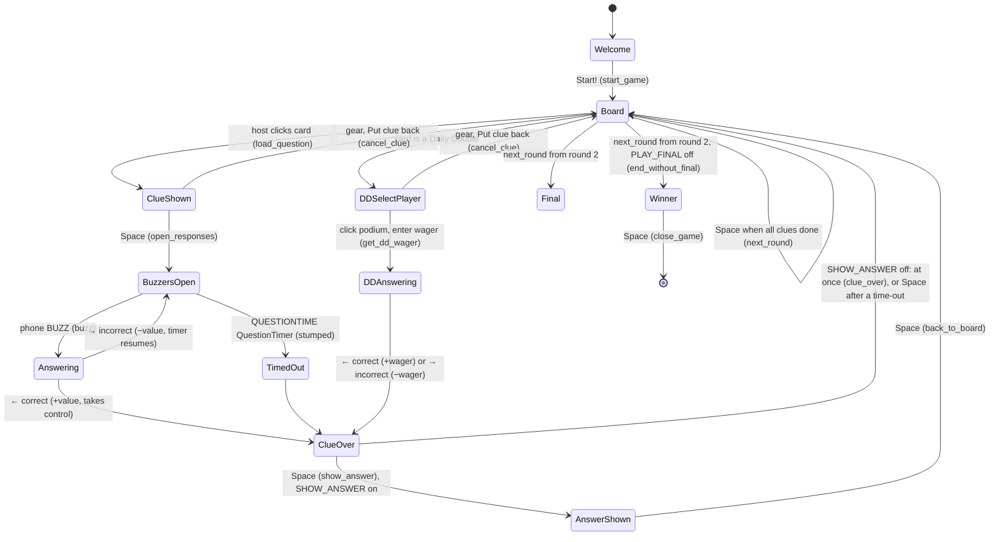
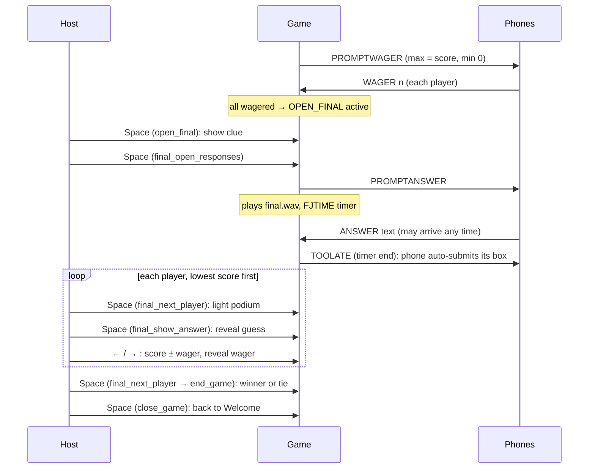

# Game flow

All game logic is in the `Game` class in [jparty/game.py](../jparty/game.py). There is no state enum: the current state is the set of key events that `KeystrokeManager` has active, plus a few flags on `Game` (`active_question`, `accepting_responses`, `answering_player`, `soliciting_player`, `final_skipped`, `current_round`).

## Key events

Registered in `Game.__init__`. Each fires once and deactivates itself.

| Event | Key | Handler | Active when |
| --- | --- | --- | --- |
| `OPEN_RESPONSES` | Space | `open_responses` | A normal clue is showing and has not been opened yet |
| `CORRECT_ANSWER` | ← | `correct_answer` | A player has buzzed, or a Daily Double wager is set |
| `INCORRECT_ANSWER` | → | `incorrect_answer` | Same |
| `SHOW_ANSWER` | Space | `show_answer` | `SHOW_ANSWER` is on and the clue is over: answered correctly, a Daily Double judged, or timed out |
| `BACK_TO_BOARD` | Space | `back_to_board` | The answer is showing on the TV; with `SHOW_ANSWER` off, the clue timed out |
| `NEXT_ROUND` | Space | `next_round` | Every clue on the board is complete |
| `OPEN_FINAL` | Space | `open_final` | Every player has wagered in the final |
| `FINAL_OPEN_RESPONSES` | Space | `final_open_responses` | The final clue is showing |
| `FINAL_NEXT_PLAYER` | Space | `final_next_player` | The music ended, or a final answer was judged |
| `FINAL_SHOW_ANSWER` | Space | `final_show_answer` | A player is up for judgement |
| `FINAL_CORRECT_ANSWER` / `FINAL_INCORRECT_ANSWER` | ← / → | `final_correct_answer` / `final_incorrect_answer` | That player's answer is revealed |
| `CLOSE_GAME` | Space | `close_game` | The winner is showing (after the final, or after round 2 when `PLAY_FINAL` is off) |

Activating an event also calls its hint setter (`spacehints` or `arrowhints`), which flashes the key image in the host's side borders.

## Regular rounds

Details:

- `open_responses` lights the borders, sleeps `BUZZER_DELAY` (0.25 s), then sets `accepting_responses`. The `QUESTIONTIME` timer pauses while someone is answering and resumes after a wrong answer.
- An accepted buzz plays `buzz.wav` (`Game.buzz_sound`, loaded once in `__init__`) before anything else, to keep it in time with the press.
- When a clue is over, `correct_answer` and a judged Daily Double call `clue_over`, and `stumped` activates the next event itself (it runs on the timer thread). With `SHOW_ANSWER` on in [constants.py](../jparty/constants.py), the next Space calls `show_answer`, which replaces the clue on the TV with the answer in gold (`QuestionWidget.show_answer`, called on `main_display` only), and the Space after that returns to the board. With it off, a judged clue returns to the board at once and a timed-out one waits for Space, as before. A wrong answer on a normal clue reopens the buzzers either way.
- With `LOCKOUT_WRONG_ANSWERS` on, `incorrect_answer` adds the player to `Game.locked_out` and `buzz` ignores everyone in it, so each player gets one try per clue. `load_question` empties the set. With it off nobody is ever locked out, including the player who just answered.
- A buzz while no clue is open just blinks that player's podium, which is useful for testing phones in the lobby.
- Daily Double: `soliciting_player` is set, so clicking a podium calls `get_dd_wager`. Maximum wager is `max(score, 1000)`. Cancelling the dialog lets the host choose a different player. A wrong Daily Double answer returns straight to the board.
- Entering round 2, the player with the lowest score gets the "in control" glow on the host screen.
- A category whose name is blank is not played (custom games with fewer than 6 categories). `Board.__init__` marks its clues complete, so the round ends without them, and `BoardWidget.load_round` hides the column (`show_column`) so the others fill the board. `BoardWidget.clear` shows every column again.
- The gear dialog's Next/Previous round buttons call `next_round` / `prev_round` directly, regardless of how many clues remain. They and Allow new players are hidden while a clue is on screen (`active_question` set).
- The gear stays visible during a clue, and its dialog then shows End clue and Put clue back instead (`InGameSettingsDialog.disable_buttons`). `HostDisplayWindow.load_question` and `hide_question` close any open dialog (`close_settings`), since its buttons depend on whether a clue is showing.
  - **End clue** (`end_clue`, enabled while `can_end_clue`: a clue is showing and `BACK_TO_BOARD` is not active): cancels the timer, closes the buzzers, deactivates `OPEN_RESPONSES` / `SHOW_ANSWER`, stops an answering player (`answer_given`), reveals an unwagered Daily Double's clue, and changes no score. Then, with `SHOW_ANSWER` on, it shows the answer on the TV at once and activates `BACK_TO_BOARD`; with it off it calls `back_to_board`. The card is used up.
  - **Put clue back** (`cancel_clue`, enabled while `can_cancel_clue`: `OPEN_RESPONSES` is active, or a Daily Double still has `soliciting_player` set): hides the clue and puts the `Question` back on its card through `BoardWidget.set_question`, uncompleted, so it can be picked again.
- With `PLAY_FINAL = False` in [constants.py](../jparty/constants.py), `next_round` from round 2 calls `end_without_final` instead of loading the final: it sets `final_skipped`, overlays the `FinalDisplay` on the round 2 board and calls `end_game`, which lights the winner's podium and activates `CLOSE_GAME`. `current_round` stays on round 2, so `is_final()` stays false and no wagers are requested. While `final_skipped` is set the gear dialog disables Next round, and Previous round removes the winner overlay, turns off the podium lights and deactivates `CLOSE_GAME`, leaving the round 2 board. The game data must still contain a final clue, since `valid_game` checks every round.

## Final round

`close_game` closes every phone socket, clears players and game data, cancels any running timer, clears the clue state and deactivates every key event (`KeystrokeManager.deactivate_all`, since **Quit game** can be used mid-clue), re-opens registration, resets both displays and restarts the theme song.

## Players joining and leaving

- Registration is open while `BuzzerController.accepting_players` is true: before the game starts, and whenever the host chooses **Allow new players** (`Game.modify_players(True)`), which also re-shows the QR code on the player screen.
- `Game.players` and `BuzzerController.connected_players` are the same list object once a player has joined.
- `Game.startable()` requires a complete game and at least one connected player.
- Closing a phone's socket does not remove the player. The phone reloads itself, sends its stored token, and is re-attached to the same `Player` (see [buzzer-protocol.md](buzzer-protocol.md)).
