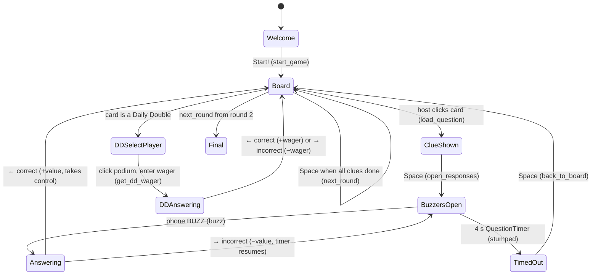
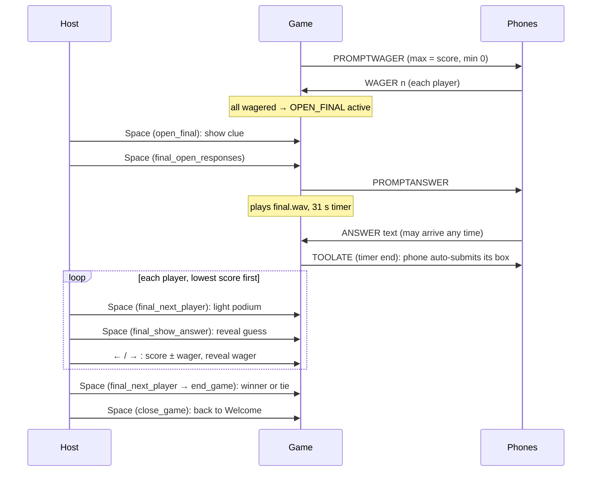

# Game flow

All game logic is in the `Game` class in [jparty/game.py](../jparty/game.py). There is no state enum: the current state is the set of key events that `KeystrokeManager` has active, plus a few flags on `Game` (`active_question`, `accepting_responses`, `answering_player`, `soliciting_player`, `current_round`).

## Key events

Registered in `Game.__init__`. Each fires once and deactivates itself.

| Event | Key | Handler | Active when |
| --- | --- | --- | --- |
| `OPEN_RESPONSES` | Space | `open_responses` | A normal clue is showing and has not been opened yet |
| `CORRECT_ANSWER` | ← | `correct_answer` | A player has buzzed, or a Daily Double wager is set |
| `INCORRECT_ANSWER` | → | `incorrect_answer` | Same |
| `BACK_TO_BOARD` | Space | `back_to_board` | The clue timed out |
| `NEXT_ROUND` | Space | `next_round` | Every clue on the board is complete |
| `OPEN_FINAL` | Space | `open_final` | Every player has wagered in the final |
| `FINAL_OPEN_RESPONSES` | Space | `final_open_responses` | The final clue is showing |
| `FINAL_NEXT_PLAYER` | Space | `final_next_player` | The music ended, or a final answer was judged |
| `FINAL_SHOW_ANSWER` | Space | `final_show_answer` | A player is up for judgement |
| `FINAL_CORRECT_ANSWER` / `FINAL_INCORRECT_ANSWER` | ← / → | `final_correct_answer` / `final_incorrect_answer` | That player's answer is revealed |
| `CLOSE_GAME` | Space | `close_game` | The winner is showing |

Activating an event also calls its hint setter (`spacehints` or `arrowhints`), which flashes the key image in the host's side borders.

## Regular rounds

Details:

- `open_responses` lights the borders, sleeps `BUZZER_DELAY` (0.25 s), then sets `accepting_responses`. The 4-second timer pauses while someone is answering and resumes after a wrong answer.
- `buzz` ignores the player stored in `previous_answerer`, i.e. only the most recent answerer is locked out.
- A buzz while no clue is open just blinks that player's podium, which is useful for testing phones in the lobby.
- Daily Double: `soliciting_player` is set, so clicking a podium calls `get_dd_wager`. Maximum wager is `max(score, 1000)`. Cancelling the dialog lets the host choose a different player. A wrong Daily Double answer returns straight to the board.
- Entering round 2, the player with the lowest score gets the "in control" glow on the host screen.
- The gear dialog's Next/Previous round buttons call `next_round` / `prev_round` directly, regardless of how many clues remain.

## Final round

`close_game` closes every phone socket, clears players and game data, re-opens registration, resets both displays and restarts the theme song.

## Players joining and leaving

- Registration is open while `BuzzerController.accepting_players` is true: before the game starts, and whenever the host chooses **Allow new players** (`Game.modify_players(True)`), which also re-shows the QR code on the player screen.
- `Game.players` and `BuzzerController.connected_players` are the same list object once a player has joined.
- `Game.startable()` requires a complete game and at least one connected player.
- Closing a phone's socket does not remove the player. The phone reloads itself, sends its stored token, and is re-attached to the same `Player` (see [buzzer-protocol.md](buzzer-protocol.md)).
