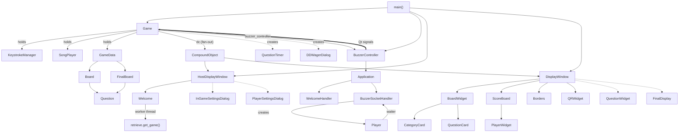

# Knowledge graph

A map of the things in this repository and how they relate. The machine-readable version is [knowledge-graph.json](knowledge-graph.json).

## The JSON file

```
{ "nodes": [ { "id", "type", ... } ], "edges": [ { "source", "target", "relation", ... } ] }
```

136 nodes and 283 edges.

| Node type | Count | ID prefix | Extra fields |
| --- | --- | --- | --- |
| `module` | 20 | `module:` | `path`, `lines` |
| `class` | 57 | `class:` | `module`, `line`, `methods` |
| `function` | 18 | `function:` | `module`, `line` (module-level functions only) |
| `external_package` | 25 | `package:` | |
| `external_class` | 12 | `extclass:` | Qt / Tornado base classes |
| `external_system` | 4 | `service:`, `client:` | `label` |

| Relation | Count | Meaning | Source |
| --- | --- | --- | --- |
| `defines` | 75 | module → class or function | AST |
| `uses` | 66 | module → external package | AST |
| `inherits` | 49 | class → base class | AST |
| `imports` | 45 | module → module (with `names`) | AST |
| `contains`, `creates`, `holds`, `calls`, `routes`, `signals`, `fetches`, `sends` | 48 | Runtime relationships, each with a `note` | Hand-written, `"curated": true` |

The first four relations were extracted mechanically from the Python syntax tree and are exact as of v2.1.1. The curated edges describe runtime behaviour and were written from reading the code. The file is a snapshot and will not update itself when the code changes.

Example query, "what does `Game` hold or create?":

```
jq '.edges[] | select(.source=="class:Game" and .curated)' docs/knowledge-graph.json
```

## Runtime object graph

Who creates and holds whom while the app is running.



## Class hierarchy

The Tornado handlers, exceptions, `QRImage`, `JPartyStyle`, `UncaughtHook`, `FinalDisplay` and `FinalAnswerWidget` each inherit directly from a library class and are left out here; they are in the JSON.

```mermaid
classDiagram
    QMainWindow <|-- DisplayWindow
    DisplayWindow <|-- HostDisplayWindow

    QWidget <|-- StartWidget
    StartWidget <|-- Welcome
    StartWidget <|-- QRWidget
    StartWidget <|-- SettingsDialog
    SettingsDialog <|-- PlayerSettingsDialog
    SettingsDialog <|-- InGameSettingsDialog
    QDialog <|-- NewPlayersPopup
    QDialog <|-- DDWagerDialog

    QWidget <|-- QuestionWidget
    QuestionWidget <|-- HostQuestionWidget
    QuestionWidget <|-- DailyDoubleWidget
    QuestionWidget <|-- FinalJeopardyWidget
    HostQuestionWidget <|-- HostDailyDoubleWidget
    DailyDoubleWidget <|-- HostDailyDoubleWidget
    FinalJeopardyWidget <|-- HostFinalJeopardyWidget
    HostQuestionWidget <|-- HostFinalJeopardyWidget

    QWidget <|-- CardLabel
    CardLabel <|-- CategoryCard
    CardLabel <|-- QuestionCard
    QuestionCard <|-- HostQuestionCard
    QWidget <|-- BoardWidget

    QWidget <|-- PlayerWidget
    PlayerWidget <|-- HostPlayerWidget
    QWidget <|-- ScoreBoard
    ScoreBoard <|-- HostScoreBoard

    Borders <|-- HostBorders
    QWidget <|-- BorderWidget
    BorderWidget <|-- HostBorderWidget

    QLabel <|-- DynamicLabel
    AutosizeWidget <|-- DynamicLabel
    DynamicLabel <|-- MyLabel
    MyLabel <|-- NameLabel
    QPushButton <|-- DynamicButton
    AutosizeWidget <|-- DynamicButton

    QObject <|-- Game
    Board <|-- FinalBoard
```



## Concepts and where they live

| Concept | Code |
| --- | --- |
| Game rules and state | `Game` in [game.py](../jparty/game.py) |
| Which key does what, and when | `KeystrokeManager` and the `addEvent` calls in `Game.__init__` |
| A clue | `Question` |
| A round | `Board` / `FinalBoard` |
| A contestant | `Player` (state) and `PlayerWidget` (podium) |
| A contestant's phone | `BuzzerSocketHandler` (`Player.waiter`) and [buzzer.js](../jparty/buzzer/static/buzzer.js) |
| Host screen | `HostDisplayWindow` and every `Host…` class |
| TV screen | `DisplayWindow` and the base classes |
| Choosing a game | `Welcome` → [retrieve.py](../jparty/retrieve.py) |
| Buzz window timing | `QuestionTimer`, `QUESTIONTIME`, `BUZZER_DELAY` |
| Sounds | `SongPlayer` (theme, final) and direct `simpleaudio` calls (`dd.wav`, `applause.wav`, `stumped.wav`, `board_fill.wav`; `Game.buzz_sound` plays `buzz.wav`) |
| Daily Double | `Question.dd`, `Game.soliciting_player`, `Game.get_dd_wager`, `DDWagerDialog`, `DailyDoubleWidget` |
| Final round | `FinalBoard`, the `final_*` methods on `Game`, `FinalJeopardyWidget`, `FinalDisplay` |
| Mid-game admin | [settings.py](../jparty/settings.py) |
